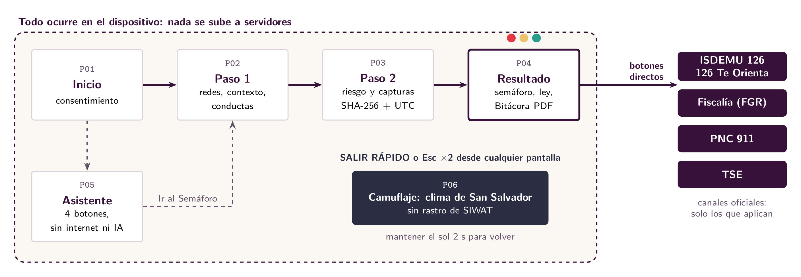

# SIWAT — «Dale color a lo que otros invisibilizan»

Prototipo web del Hackatón Nacional «Innovando por una participación política segura» (2026).
Semáforo de Violencia Política Digital: autodiagnóstico legal, respaldo de evidencia con integridad
verificable y botones directos a los canales oficiales de El Salvador.

> SIWAT orienta; no interpone denuncias ni sustituye a las instituciones del Estado.

## Funcionalidades

| Pantalla | Qué hace |
|---|---|
| P01 Inicio | Consentimiento obligatorio, botón «Estoy en peligro físico ahora» (911 / 126), acceso al asistente y espacio local opcional con seudónimo + PIN. |
| P02 Paso 1 | Rol y departamento (opcionales), redes, contexto electoral y 6 conductas. |
| P03 Paso 2 | Dos filtros de riesgo, aviso «guarda antes de bloquear», URL, hasta 3 capturas con **SHA-256 + sello UTC** calculados en el navegador, relato de 500 caracteres. |
| P04 Resultado | Sello rojo / amarillo / verde (color + forma + texto), artículos de LEIV, LEDIC, Código Electoral, LIE y Belém do Pará, **Bitácora PDF** con código `SIWAT-2026-XXXX`, pasos para reportar en cada red, botones directos a PNC 911, FGR, ISDEMU 126 / 126 Te Orienta y TSE, checklist de blindaje, «Limpiar datos de este dispositivo». |
| P05 Asistente | 4 botones fijos, funciona sin internet y sin IA. |
| P06 Camuflaje | «SALIR RÁPIDO» o `Esc` dos veces: pantalla de clima de San Salvador sin rastro de SIWAT (cambia título y favicon). Mantener presionado el sol 2 s para volver. |

## Cómo funciona




Las figuras se generan desde LaTeX (`docs/figures/src/*.tex`) con `steamr figure render`.

## Privacidad por diseño (verificable)

- Sin servidor: todo vive en `sessionStorage` (se borra al cerrar la pestaña).
- Espacio local opcional cifrado con AES-GCM; la clave se deriva de seudónimo + PIN con PBKDF2 (el seudónimo nunca se guarda).
- Las capturas nunca salen del dispositivo: solo se guardan su nombre, tamaño, SHA-256 y hora UTC.
- La versión publicada incluye una **Content-Security-Policy** (`connect-src 'self'`): el propio navegador bloquea cualquier envío de datos a otro dominio.
- Historial en memoria: los pasos no quedan en el historial del navegador.
- Sin fuentes, iconos ni scripts de terceros en tiempo de ejecución; funciona sin conexión (PWA).

## Herramientas

Vue 3 + TypeScript + Vite · vue-router · jsPDF (carga diferida) · Web Crypto (`SubtleCrypto`) · vite-plugin-pwa ·
iconos Lucide compilados con unplugin-icons · Atkinson Hyperlegible (autoalojada) · Vitest.

## Arquitectura (por funcionalidad, puertos y adaptadores)

```
src/
  app/                 App.vue, router (memoria)
  features/
    diagnosis/domain/  motor de clasificación + base legal (sin dependencias de Vue)
    evidence/domain/   SHA-256, validación de capturas, código de caso
    evidence/          subida de capturas, generador de Bitácora PDF
    case/              estado del caso; puerto CaseRepository + adaptadores sessionStorage y bóveda con PIN
    result/            P04, catálogo de instituciones y pasos de reporte, estadística anónima
    welcome/ assistant/ camouflage/
  shared/ui/           cabecera, pie, folio, sello, diálogos
  styles/              tokens y controles
```

## Uso

```sh
pnpm install
pnpm dev        # desarrollo
pnpm test       # pruebas del dominio
pnpm build      # genera dist/
pnpm preview    # sirve dist/ localmente
```

## Publicar (enlace público gratuito)

- **Netlify Drop:** `pnpm build` y arrastra la carpeta `dist/` a https://app.netlify.com/drop.
- **GitHub Pages:** publica el contenido de `dist/` (rutas relativas, funciona en subcarpetas).

## Pendiente de validar con el equipo

- Logo oficial (el isotipo actual es provisional).
- Texto del Manual ANDRYSAS para los pasos de reporte por red (los actuales son genéricos).
- Regla «ROJO / AMARILLO» para suplantación o montaje: hoy es amarillo salvo que haya amenaza o exposición de datos.
- Desinformación fuera de contexto electoral: hoy cae en verde preventivo.
- La estadística anónima solo se muestra; no se envía (Fase 2).
