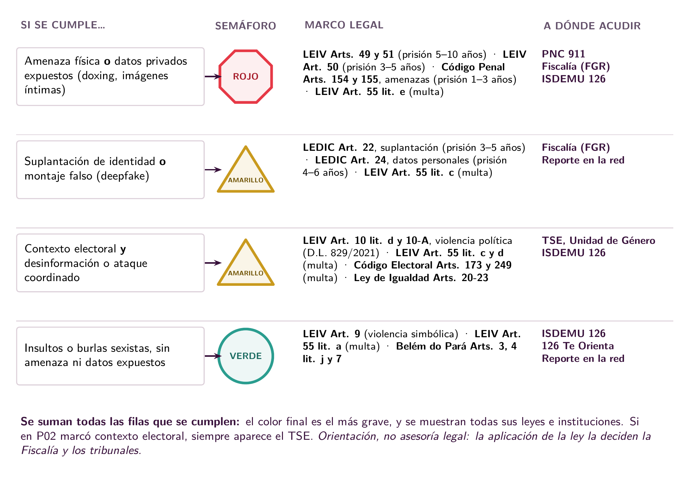

# SIWAT — «Dale color a lo que otros invisibilizan»

Prototipo web del Hackatón Nacional «Innovando por una participación política segura» (2026).
Semáforo de Violencia Política Digital: autodiagnóstico legal, respaldo de evidencia con integridad
verificable y botones directos a los canales oficiales de El Salvador.

> SIWAT orienta; no interpone denuncias ni sustituye a las instituciones del Estado.

## Funcionalidades

| Pantalla | Qué hace |
|---|---|
| P01 Inicio | Consentimiento obligatorio, botón «Estoy en peligro físico ahora» (911 / 126), acceso al asistente y a las opciones de accesibilidad. |
| P02 Paso 1 | Rol y departamento (opcionales; «Otro» admite texto libre), redes con sus iconos (incluye «Otra» con texto libre y «Prefiero no decirlo», que excluye a las demás), contexto electoral y 6 conductas. |
| P03 Paso 2 | Dos filtros de riesgo (más una pregunta sobre imágenes íntimas o sexuales solo si hubo exposición o deepfake), aviso «guarda antes de bloquear», URL, hasta 3 capturas con **SHA-256 + sello UTC** calculados en el navegador, relato de 500 caracteres. |
| P04 Resultado | Sello rojo / amarillo / verde (color + forma + texto), solo los artículos de LEIV, LEDIC, Código Penal, Código Electoral, LIE y Belém do Pará que aplican a lo que marcó (con el aviso «Orientación, no asesoría legal»), **Bitácora PDF** con código `SIWAT-2026-XXXX`, pasos para reportar en cada red según el manual de ANDRYSAS, botones directos a PNC 911, FGR, ISDEMU 126 / 126 Te Orienta y TSE, checklist de blindaje, «Limpiar datos de este dispositivo». |
| P05 Asistente | 4 botones fijos, funciona sin internet y sin IA. |
| P06 Camuflaje | «SALIR RÁPIDO» o `Esc` dos veces: pantalla de clima de San Salvador sin rastro de SIWAT (cambia título y favicon). Para volver: mantener presionado el sol 2 s o activarlo 3 veces en 2 s (funciona con lector de pantalla). |

## Cómo funciona




Las figuras se generan desde LaTeX (`docs/figures/src/*.tex`) con `steamr figure render`.

## Privacidad por diseño (verificable)

- Sin servidor: todo vive en `sessionStorage` (se borra al cerrar la pestaña).
- Las capturas nunca salen del dispositivo: solo se guardan su nombre, tamaño, SHA-256 y hora UTC.
- La versión publicada incluye una **Content-Security-Policy** (`connect-src 'self'`): el propio navegador bloquea cualquier envío de datos a otro dominio.
- Historial en memoria: los pasos no quedan en el historial del navegador.
- Sin fuentes, iconos ni scripts de terceros en tiempo de ejecución; funciona sin conexión (PWA).
- El idioma elegido también vive solo en `sessionStorage`, y «Limpiar datos de este dispositivo» lo devuelve a español.

## Accesibilidad

SIWAT está pensado para funcionar con el lector de pantalla del teléfono (TalkBack, VoiceOver): encabezados,
etiquetas, foco al cambiar de pantalla y una única región `aria-live` que anuncia el resultado. No hay un lector propio
que hable encima del del teléfono. El panel «Opciones de accesibilidad» (pie de página y portada) ofrece, opcionalmente,
texto más grande (125 %), alto contraste (también automático con `prefers-contrast: more`) y «Leer en voz alta» con
`speechSynthesis` en el idioma activo, previa advertencia de usar audífonos. «SALIR RÁPIDO» y `Esc` dos veces detienen la
lectura al instante. Las opciones viven solo en `sessionStorage`, se borran con «Limpiar datos de este dispositivo», y
SIWAT nunca detecta ni registra el uso de tecnologías de apoyo.

## Idiomas

Español (predeterminado, nunca se detecta del navegador), English, 简体中文 y Deutsch, con un selector en la portada y
en el pie. Los textos están en `src/i18n/locales/*.json` (español incluido en el paquete; los demás se cargan al
elegirlos). La Bitácora PDF se genera siempre en español para presentarla ante instituciones salvadoreñas, y los
nombres oficiales de las leyes no se traducen: cada resumen legal tiene un id estable (`legal.<id>`) en cada idioma.

## Herramientas

Vue 3 + TypeScript + Vite · vue-router · vue-i18n · jsPDF (carga diferida) · Web Crypto (`SubtleCrypto`) · vite-plugin-pwa ·
iconos Lucide y Simple Icons (marcas de las plataformas) compilados con unplugin-icons · Atkinson Hyperlegible (autoalojada) · Vitest.

## Arquitectura (por funcionalidad, puertos y adaptadores)

```
src/
  app/                 App.vue, router (memoria)
  i18n/                vue-i18n, idioma en sessionStorage, mensajes por idioma
  features/
    diagnosis/domain/  motor de clasificación + base legal (sin dependencias de Vue)
    evidence/domain/   SHA-256, validación de capturas, código de caso
    evidence/          subida de capturas, generador de Bitácora PDF
    case/              estado del caso; puerto CaseRepository + adaptador sessionStorage
    result/            P04, catálogo de instituciones y pasos de reporte
    accessibility/     panel de opciones, lectura en voz alta, preferencias en sessionStorage
    welcome/ assistant/ camouflage/
  shared/ui/           cabecera, pie, folio, sello, diálogos
  styles/              tokens y controles
```

## Uso

```sh
pnpm install
pnpm dev        # desarrollo
pnpm test       # pruebas del dominio
pnpm build      # genera dist/
pnpm preview    # sirve dist/ localmente
```

## Publicar (enlace público gratuito)

- **Netlify Drop:** `pnpm build` y arrastra la carpeta `dist/` a https://app.netlify.com/drop.
- **GitHub Pages:** publica el contenido de `dist/` (rutas relativas, funciona en subcarpetas).

## Pendiente de validar con el equipo

- Logo oficial (el isotipo actual es provisional).
- Texto del Manual ANDRYSAS para los pasos de reporte por red (los actuales son genéricos).
- Regla «ROJO / AMARILLO» para suplantación o montaje: hoy es amarillo salvo que haya amenaza o exposición de datos.
- Desinformación fuera de contexto electoral: hoy cae en verde preventivo.

## Licencia

SIWAT se distribuye bajo la [GNU General Public License v3.0](LICENSE) (`GPL-3.0-only`): puedes usarlo, estudiarlo, modificarlo y compartirlo, siempre que las versiones que distribuyas mantengan la misma licencia y su código fuente.
